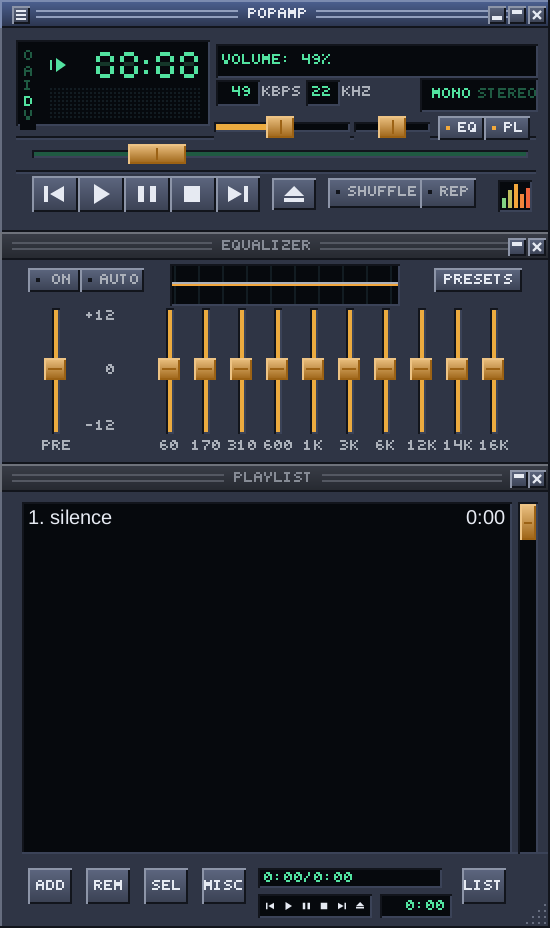

# Popamp Default

# ⚠️ This skin was generated automatically

## It needs a designer's edits to make it simpler

The pictures were written by a program, not drawn by a designer, so the
files are more complicated than the skin needs. Fork it and redraw it.

Popamp's own skin, the one the player starts with and where every other
skin takes what it leaves out. It draws every classic sheet in SVG, so it
is also a complete example of the
[vector skin format](https://github.com/popamp/popamp/blob/main/docs/skin-format.md).

Besides the classic windows it has a bar view of the main window (the main
menu's Toolbar mode), a media library window with its own title, and five
colour sets for the metal (Slate, Graphite, Plum, Pine and Wine) in the
main menu's Colours.

The SVG files and `skin.toml` are written by `tools/gen.py`
(`python3 -I -B tools/gen.py`). Every window is put together from the
same parts in `tools/parts.py`: one panel and edge, one title strip with
one set of title buttons, where only the window's name differs, one kind
of button, well and thumb. `text.svg` and `numbers.svg`, the lettering,
are drawn by hand and the script reads its letters from `text.svg`.



A vector skin for [Popamp](https://github.com/popamp/popamp), skin format
version 1. All artwork is the skin's own.

## Change it

This repository is an ordinary skin. Fork it, then clone your fork into
Popamp's skins folder:

```sh
git clone https://github.com/<you>/popamp-skin-default ~/.local/share/popamp/skins/my-default
```

Give it a name of its own in `skin.toml` (`name = "..."`), and pick it in
the main menu's skin list. Popamp reloads the skin when a file changes.
`Cargo.toml` and `src/` are not part of the skin and Popamp does not read
them. An archive for the [skin gallery](https://popamp.app) holds only
`skin.toml`, the SVG files, the README and the licenses.

## How Popamp builds it in

The skin is also a small Rust crate that gives the player the files'
bytes. Popamp depends on it:

```toml
popamp-skin-default = { git = "https://github.com/popamp/popamp-skin-default", branch = "main" }
```

Popamp's `Cargo.lock` pins the commit, so a change here reaches the player
after `cargo update -p popamp-skin-default` there. A new SVG file goes
into the list in [src/lib.rs](src/lib.rs); `cargo test` says when one is
missing.

## License

Licensed under either of [Apache License 2.0](LICENSE-APACHE) or
[MIT license](LICENSE-MIT) at your option.
